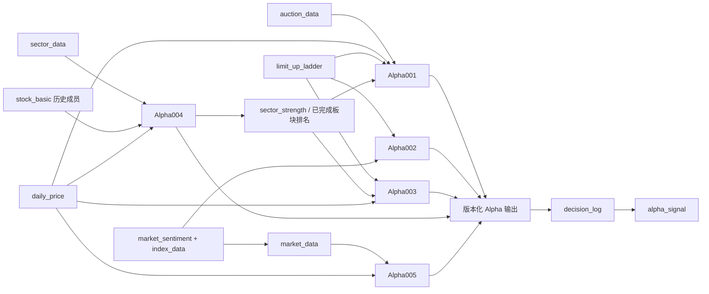

# AI Alpha OS Alpha 数据映射架构

所属任务：Sprint 1.6 — Design Alpha Data Mapping Architecture。日期：2026-09-17。

状态：设计规范；仅定义数据、因子、评分、信号与验证的关系。当前没有 Alpha 实现、已验证参数或获准实盘运行的模型。

## 一、设计目标

```text
数据输入 → 因子计算 → Alpha评分 → 交易信号 → 回测验证
```

所有 Alpha 必须明确数据来源，避免黑箱。每次结果均能追溯到原始记录、来源选择、数据版本、计算逻辑、参数及决策时间。评分不等于订单，信号不等于成交，回测结果不等于实盘授权。

沿用 [数据契约](../data/DATA_CONTRACT.md)、[数据库模型](../data/DATABASE_SCHEMA.md)、[评分框架](ALPHA_SCORING.md) 与 [研究协议](../research/RESEARCH_PROTOCOL.md)。新增字段和跨股票、板块、市场输出属于逻辑扩展，须先补齐契约并审查再实施，不宣称已存在物理表。

## 二、Alpha 标准结构

每个 Alpha 以稳定 ID 登记；规则或参数变化创建新版本，不复用旧版本的研究批准。

| 标准项 | 必需内容 |
| --- | --- |
| Alpha ID | 例如 Alpha001，全局稳定标识 |
| Alpha名称 | 例如竞价强度Alpha，不以名称替代 ID |
| 目标与假设 | 预期识别什么、适用范围、失效与否证条件 |
| 输入数据 | 数据集、数据库字段、实体键、频率、时间窗口、主备来源资格及数据版本 |
| 数据时点 | signal_time、available_at、ingested_at、历史有效期及允许延迟 |
| 计算逻辑 | 原始字段如何转换为因子、如何归一化、组合及过滤，参数版本 |
| 输出结果 | 股票评分、股票排名、交易信号或市场/板块状态，明确对象与分数方向 |
| 缺失处理 | 必需和可选依赖，拒绝计算条件、状态与原因 |
| 验证方式 | 固定交易评价协议，报告胜率、收益率、最大回撤、夏普比率及样本量 |
| 审计与治理 | strategy_version、parameter_version、input_data_version、decision_id、生命周期状态和审批引用 |

外部供应商尚未选定。每次运行必须从 [数据源策略](../data/DATA_SOURCE_STRATEGY.md) 的合格来源登记中解析具体 source 与 source_selection_version，不能只写“来自行情数据”而没有输入清单。

### 共用计算与评分约定

- 股票以稳定 stock_id 连接，按历史身份映射 stock_code；板块以 sector_id、市场或指数以独立对象标识连接。
- 历史回放仅使用 available_at 不晚于决策时间的输入；前向模拟使用 available_at 与 ingested_at 的较晚值，派生输出还须晚于计算完成时间。
- 窗口长度、权重、阈值、参数搜索范围与归一化方法均待独立研究确定，不设置隐藏默认值。训练统计不能使用验证或样本外未来数据。
- Alpha001–Alpha004 的展示分数为 0–100，越高表示对应强度或进攻环境更高；Alpha005 的 risk_score 为 0–100，越高表示风险越高。
- 输入不足或必要参数未配置时输出 null 与 insufficient_data / invalid_config，不能以 0 代替缺失或临时重分配权重。
- 股票排名限定同一 Alpha 版本、时间、股票池和 ranking_batch_id；市场状态不伪装成股票排名，跨 Alpha 分数不直接混排。

### 共用验证指标

各模型先冻结“评分如何转为组合、持有与退出规则”的评价协议，再产生交易绩效。市场状态、板块强度和风险模型通过与固定基线的组合对照验证，不能把状态分类本身直接称为盈利策略。

| 指标 | 计算与报告口径 |
| --- | --- |
| 胜率 | 净损益大于 0 的已闭合持仓周期数 / 全部已闭合周期数；盈亏为零计分母，无闭合交易则 null |
| 收益率 | 无外部现金流的账户净值 E_T / E_0 - 1，包含适用成本，注明区间 |
| 最大回撤 | 含成本净值相对此前历史峰值的最大下降比例；注明日终或其他估值频率 |
| 夏普比率 | 固定频率超额收益 x_t = r_t - rf_t；周期夏普 = mean(x_t) / sample_std(x_t)，年化展示乘 sqrt(N)；N、无风险收益来源和转换口径事先固定 |
| 辅助信息 | 样本区间、闭合交易数、持仓暴露、成本、未成交、数据覆盖、置信与稳定性限制 |

夏普使用同频率净值收益，包含持币期间，不仅抽取盈利交易日；少于两个有效收益点、标准差为零或必要输入缺失时为 null。无风险收益使用零值仅能作为明确声明的研究假设。平方根年化是估计口径，存在序列相关时需说明局限，不保证可直接跨频率比较。账户收益与回撤沿用 [回测规则](../backtest/BACKTEST_RULES.md)。

## 三、输入名称与契约补充边界

| 本次输入名称 | 对应设计与字段 | 状态 |
| --- | --- | --- |
| auction_data | 竞价表及时间、类型、量价字段 | 已有数据库逻辑设计，未建表 |
| daily_price | 日线量价、换手率、参考价与状态 | 已有数据库逻辑设计，未建表 |
| limit_up_ladder | 梯队、连板、首次涨停时间与池级炸板率引用 | 已有数据库逻辑设计，未建表 |
| stock_basic | 股票属性与历史行业概念投影 | 已有数据库逻辑设计，需通过时点成员关系连接 |
| market_sentiment | 数据契约已有 limit_up_count、max_consecutive_limit_up、failed_limit_up_rate、market_turnover | 已有逻辑数据集，物理设计待定；跌停数量等需扩展 |
| sector_data | sector_membership、sector_snapshot 的版本化逻辑视图 | 非现有物理表；板块排名等是新增派生字段 |
| sector_strength | Alpha004 已完成且可用的板块评分视图 | 新逻辑视图，不是独立原始数据源 |
| index_data | 指数时点量价及身份 | 新契约待设计，不使用股票代码冒充指数身份 |
| market_data | index_data 与 market_sentiment 的同截止时点市场视图 | 新逻辑视图，不重复采集一份未知来源数据 |

### 必须补齐的最小逻辑扩展

| 字段或关系 | 类型与粒度 | 语义与约束 |
| --- | --- | --- |
| market_sentiment.limit_down_count | int64?，股票池 × 截止时点 | 处于适用跌停价的证券数；关键数据缺失为 null；无跌停限制证券不纳入 |
| index_data.index_id、trade_date、snapshot_time | string、date、timestamp | 指数身份和时点，关联来源与版本 |
| index_data.close、prev_close、return_rate | decimal? | 明确日终或已完成区间口径；return_rate = close / prev_close - 1 |
| market_sentiment.market_trend | decimal?，股票池/基准 × 截止时点 × metric_version | 从预选指数历史序列派生，关联 index_data 输入清单；窗口和算法待研究 |
| sector_data.sector_rank | int64?，板块集合 × 截止时点 × ranking_batch_id | 按冻结的原始板块评价方法或已完成 Alpha004 结果排名，说明方法与并列规则 |
| sector_data.leader_performance | decimal?，板块 × 截止时点 | 使用此前已确认的龙头候选集合计算当前可用表现；首次运行用预注册的历史原始规则种子，不能用同时刻 Alpha003 输出 |
| sector_strength.sector_strength_score | decimal?，sector_id × signal_time × strategy_version | 引用已完成 Alpha004 记录与输入版本，不另算同名不同口径 |
| sector_data.member_snapshot_ref | string | 指向当时可知的板块成员清单，提供覆盖和分类版本 |

这些扩展均需继承 data_version、source、available_at、ingested_at、quality_flags 和 lineage_refs。跌停数量不能从“跌停价字段存在”直接推断，必须结合当时有效价格、限制状态和冻结股票池判断。

## 四、第一批核心 Alpha 映射

### 1. Alpha001 竞价强度模型

目标：识别开盘前强势股票，生成竞价候选股票。输出：auction_score。

| 需要数据 | 字段映射 | 因子用途与时点 |
| --- | --- | --- |
| 竞价涨幅 | auction_data.open_gap_percent、auction_price、prev_close | 衡量相对参考价的竞价表现，区分 indicative 与 final |
| 竞价成交量 | auction_data.auction_volume、snapshot_type、auction_time | 比较历史同阶段竞价量，不把虚拟量称为实际成交 |
| 竞价金额 | auction_data.auction_amount；daily_price.amount、volume | 相对历史竞价或此前完整日流动性尺度归一化；不使用当日收盘量额 |
| 昨日涨停状态 | limit_up_ladder.limit_type、consecutive_days、is_final；daily_price.close、limit_status、limit_up_price | 上一完整交易日收盘涨停识别和交叉核对 |
| 板块强度 | sector_strength.sector_strength_score、sector_id、signal_time；历史成员关系 | 只能用已可用 Alpha004 结果，必要时使用带明确日期的上日冻结板块评分 |

计算逻辑：检验竞价快照完整性 → 构造价格、量、金额相对特征 → 加入昨日涨停场景与已知板块强度 → 归一化并按参数版本组合 → 风险闸门 → auction_score。高开幅度不无条件单调加分，合理区间由回测研究决定。

输出股票评分和批次排名，满足另行冻结触发条件才形成模拟信号。仅有9:25最终竞价数据时，在其发布并可用后评价，不能使用最终结果生成信号后回填同次竞价成交。

验证：固定候选选取、后续可成交时点与退出规则，报告共用四项绩效指标、成交率与竞价数据覆盖；缺少所需历史竞价类型时该研究不成立。

### 2. Alpha002 情绪周期模型

目标：判断市场环境。输出：market_state_score，并形成进攻、防守、空仓等待的研究状态建议。

| 需要数据 | 字段映射 | 因子用途与时点 |
| --- | --- | --- |
| 涨停数量 | market_sentiment.limit_up_count；limit_up_ladder 状态按同池校验 | 使用同一截止时点，不把逐股重复投影当独立计数 |
| 跌停数量 | market_sentiment.limit_down_count（待扩展） | 观察下行广度，缺失不当零 |
| 连板高度 | market_sentiment.max_consecutive_limit_up；limit_up_ladder.consecutive_days | 明确是最近完整交易日高度 |
| 炸板率 | market_sentiment.failed_limit_up_rate；limit_up_ladder.broken_rate 为其引用 | 保持分母和股票池一致，不平均逐股重复比率 |
| 市场成交额 | market_sentiment.market_turnover | 固定市场覆盖，盘中只比较同时间进度 |
| 市场基准 | index_data.close、prev_close、return_rate 的已完成序列 | 形成相对趋势背景，指数选择预注册 |

计算逻辑：组合涨跌停广度、连板高度、炸板率及成交活跃度的水平和变化，再结合市场基准生成 market_state_score。状态映射阈值待定；分数高低与“进攻/防守/等待”的关系需研究验证，不能直接作为自动下单命令。

输出对象为市场或冻结股票池，没有股票排名。验证时固定基础股票策略，比较有无状态控制的组合，保持同样数据、成本与样本，报告胜率、收益率、最大回撤及夏普比率；未触发交易时胜率为空而非 100%。

### 3. Alpha003 龙头识别模型

目标：识别市场核心股票并形成龙头候选。输出：leader_score。

| 需要数据 | 字段映射 | 因子用途与时点 |
| --- | --- | --- |
| 连板高度 | limit_up_ladder.consecutive_days、is_final | 历史强势持续性，不取未来最终连板 |
| 成交量变化 | daily_price.volume、amount、trade_date | 对此前已完成交易日滚动基准比较，窗口待定 |
| 板块排名 | sector_data.sector_rank、ranking_batch_id、member_snapshot_ref | 使用已完成的当前或明确滞后排名，不能挑选事后最优所属板块 |
| 首次涨停时间 | limit_up_ladder.first_limit_time、snapshot_time | 只在事件实际发生且可用后使用；盘前使用历史日，不能读取当日未来首次涨停 |

计算逻辑：将持续强度、量能变化、所在板块位置与已知涨停时点特征组合为 leader_score；支持历史候选和事件后更新两种明确标记的模式，不混用其结果。

输出股票候选评分和排名，交易信号另受策略条件与 Alpha005 风险层约束。验证固定候选持仓协议，报告四项共用指标，并与同池基准比较；不以未来涨幅最高者反向定义“龙头”标签作为输入。

### 4. Alpha004 板块强度模型

目标：发现市场主线。输出：sector_strength_score。

| 需要数据 | 字段映射 | 因子用途与时点 |
| --- | --- | --- |
| 板块涨幅 | sector_data.return_rate，来源 sector_snapshot.return_rate | 统一聚合方法与历史成员 |
| 板块成交额 | sector_data.turnover，来源 sector_snapshot.turnover；daily_price.amount | 同覆盖范围内聚合，注意 daily_price.turnover 是换手率而非金额 |
| 涨停数量 | sector_data.limit_up_count，来源 sector_snapshot.limit_up_count | 核验成员与涨停适用性 |
| 龙头表现 | sector_data.leader_performance（待扩展） | 候选身份取此前已确认版本，表现仅截至当前时点 |
| 成员与价格依据 | stock_basic.industry、concepts、effective_from、effective_to；daily_price.close、prev_close | 以历史 stock_sector_membership 为成员事实，属性是投影 |

计算逻辑：对板块相对涨幅、量额活跃度、涨停广度及滞后选定龙头的当时表现进行归一化和组合。板块覆盖不足时拒绝或按预注册允许范围明确降级，不无说明剔除差成员。

输出板块评分与板块排名，发布到 sector_strength 逻辑视图，供股票模型引用。板块信号不是股票买卖指令；验证须预先定义可模拟的成分股组合及权重，再报告四项指标，不能把板块得分直接当组合收益。

### 5. Alpha005 风险过滤模型

目标：降低风险。输入主体为 daily_price、market_sentiment，统一经 market_data 取得市场上下文。输出：risk_score，越高风险越高。

| 需要数据 | 字段映射 | 因子用途与时点 |
| --- | --- | --- |
| 大盘趋势 | market_data.market_trend → market_sentiment.market_trend → index_data 历史序列（待扩展） | 预选指数与窗口，依赖链不能隐藏 |
| 波动率 | daily_price.close、prev_close、change_percent | 从一致口径历史收益序列派生，权益调整和窗口方法需冻结 |
| 跌停数量 | market_sentiment.limit_down_count（待扩展） | 识别市场下行压力 |
| 市场高度 | market_sentiment.max_consecutive_limit_up | 观察风险背景，方向和阈值须经研究，不能简单认为越高越安全 |

计算逻辑：组合趋势恶化、波动及广度风险为可解释 risk_score，映射软惩罚或风控建议。交易状态、现金、持仓可售等硬约束仍由既有风控闸门处理，高收益评分不能抵消硬性拒绝。

市场部分可输出市场风险状态，波动率等股票部分输出逐股风险；两种对象需分开标记。risk_score 不直接作为第五项正向收益分数加入旧总分，而由明确的参数映射转换为 risk_penalty。未知风险必须标记 unknown，不视为零风险。

验证使用相同基础策略有无过滤的对照，报告四项指标、暴露变化、拒绝率与错过机会的影响；不能仅通过长时间不持仓获得低回撤便宣称发现有效 Alpha。

### 与现有评分框架的对应

| 本文结果 | 既有维度 | 使用方式 |
| --- | --- | --- |
| auction_score | auction / S_auction | Alpha001 股票维度 |
| market_state_score | sentiment / S_sentiment | Alpha002 市场上下文，时点匹配后供股票评分使用 |
| leader_score | leader / S_leader | Alpha003 股票维度 |
| sector_strength_score | sector / S_sector | Alpha004 板块结果，按历史成员关系映射到股票 |
| risk_score | risk_status、risk_penalty | Alpha005 风险输入，不改变硬闸门优先级 |

保留 PRD 的情绪修复研究与首板二进场景：情绪修复属于 Alpha002 的变化特征；首板二进以昨日首板身份为候选条件，组合 Alpha001、Alpha003、Alpha004 与风险层，不新增未经授权的策略实现。

## 五、计算依赖与数据库关系

### 1. 避免循环的计算顺序

原始数据与历史成员 → sector_data 原始统计、market_sentiment、index_data → Alpha004 与 Alpha002/Alpha005 → Alpha001 与 Alpha003 → 决策及信号。

Alpha004 的龙头表现只能使用过去已确认的候选集合或预注册原始种子，不依赖同时刻待计算的 Alpha003；Alpha003 可消费已完成 Alpha004 排名。Alpha001 不得读取自己尚未完成的 auction_strength_score 作为输入，竞价表中的同名派生量只能是明确记录来源的既有结果，不能自我加权。

每条依赖记录生产版本、截止时点与可用时间；依赖未就绪就等待或标记输入不足，不能以最新结果偷换历史结果。



### 2. 输出落库与待补 Schema

现有 alpha_signal 是股票信号表，stock_id 为必填。Alpha002 的市场输出及 Alpha004 的板块输出不能填虚假股票代码以满足约束。

本次提出 schema 扩展：为 alpha_signal 增加 subject_type（stock / sector / market）、subject_id 和 score_name；非股票对象 stock_id、stock_code 允许空，股票对象仍必填且相互一致。subject_id 分别关联股票稳定身份、板块身份或冻结市场股票池，不跨类型复用。

在扩展获审查并实施前，非股票输出只作为 decision_log.evidence_refs 所引用的不可变研究产物保留，不声称现有表已经支持统一写入。目标是所有 Alpha 输出均可关联 alpha_signal 与 decision_log，而非绕过数据库约束。

| 输出内容 | 落点与语义 |
| --- | --- |
| Alpha 身份与分数 | alpha_signal.alpha_id、alpha_name、strategy_version、score；新增 score_name 指明五类输出 |
| 时间与对象 | signal_time、trade_date、subject_type、subject_id；股票输出另有 stock_id、stock_code |
| 排名 | rank、ranking_batch_id；按同一对象类型和同一版本排名，市场状态无排名则为空 |
| 原始输入 | input_data_version 指向固定输入清单；输出 data_version 单独保存 |
| 参数与触发 | parameter_version、trigger_reason，包含特征解释与 rule_version 引用 |
| 决策依据 | decision_log.rule_trigger、input_data_version、evidence_refs，ai_reason 无 AI 时为空 |
| 结果关联 | alpha_signal.decision_record_id 指向具体生成决策；后续模拟结果追加 decision_log 事件，不覆盖原始评分 |

初次写入逻辑顺序为先生成决策证据记录，再生成信号引用；结果以待评估状态开始，后续关联 backtest run 或 paper_trade。signal_status = candidate 不表示已有买卖指令，情绪状态和风险过滤结果需说明用途。

## 六、Alpha 生命周期

```text
Idea → Research → Backtest → Out-of-Sample → Paper Trading → Production → Retirement
```

Research 在 [研究协议](../research/RESEARCH_PROTOCOL.md) 中包含 Hypothesis 与 Data 的预注册、数据准入步骤；不是省略这两个步骤。

| 阶段 | 准入与退出证据 |
| --- | --- |
| Idea | 稳定 Alpha ID、问题、价值与授权范围 |
| Research | 可否证假设、明确字段、来源与质量、冻结评价标准及时间分区 |
| Backtest | 完整输入与参数版本、含成本模拟、全部实验和失败记录 |
| Out-of-Sample | 冻结候选在未使用区间独立评价，不能重复调参后宣称独立验证 |
| Paper Trading | 使用逐时新数据的前向模拟、全部信号与未成交记录，达到预注册标准 |
| Production | 必须先取得研究协议的 Approved，完成工程验证、风险评审与部署授权；标明模拟生产或实盘模式 |
| Retirement | 记录失效、风险触发、数据依赖变化或退役决定，停止新信号并保留历史证据 |

任何 Alpha 不能直接进入实盘。Production 不自动等于实盘；实盘升级需额外明确授权和执行风险控制，当前 V1 不包括自动实盘交易。

任一阶段可暂停、退回或 Rejected，不强迫无效候选走到 Production。重大数据、规则或参数变化形成新版本并从受影响阶段重新验证；退役后恢复须新审查，不继承旧批准。未平仓头寸交由既定风险处置流程管理，不能通过删除 Alpha 或记录消除持仓。

## 七、未来扩展与当前边界

| 扩展 | 预留要求 |
| --- | --- |
| AI发现Alpha | 保存候选生成来源、提示或方法版本、数据访问范围，仍需人工可审查假设与完整研究准入 |
| 多因子模型 | 保存特征依赖图、相关性、组合权重、归一化版本与逐因子解释 |
| 机器学习模型 | 固定训练数据、特征可用时点、模型版本与样本外隔离，不训练本阶段模型 |
| 虚拟游资Arena评分 | 关联 competition_id、Agent/profile 版本及独立排名范围，不与股票 Alpha 排名混用 |
| Alpha自动淘汰机制 | 预注册失效监测、暂停与退役条件，保存原因与审核轨迹，不按单次亏损随意淘汰或删除历史 |

本次不开发任何 Python、策略、因子或数据库迁移。新增视图、字段、排名与风险映射的最终实现，以及夏普统计集成，需在独立契约与实施任务中确认。

下一步优先补齐 index_data、跌停计数、市场趋势、板块视图及跨对象 alpha_signal 契约，然后按同一时点验证五个 Alpha 的最小输入覆盖，最后冻结实验参数与评价方案。

[Alpha 索引](README.md) · [数据库模型](../data/DATABASE_SCHEMA.md) · [数据源策略](../data/DATA_SOURCE_STRATEGY.md)
