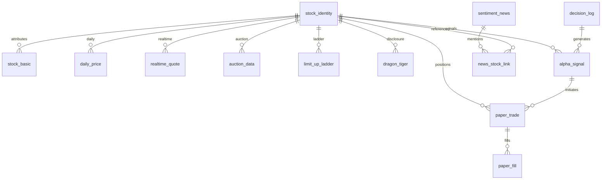

# AI Alpha OS 数据库模型设计

所属任务：Sprint 1.5 — Design AI Alpha OS Database Schema。

状态：逻辑模型设计，尚未实施。本文件保留任务指定的十张核心表及全部字段，补充类型、主键、业务唯一性、关系与版本约束。不提供 SQL、Python、迁移脚本或 ORM，不选定数据库产品。

## 一、数据库设计原则

1. 支持A股量化研究：保留证券历史身份、行业概念关系和明确口径，避免只保留当前存续股票。
2. 支持历史回测：固定数据快照，按照历史可用时点读取，保留修订、停牌与权益事件依赖。
3. 支持实时数据接入：区分事件时间、接收时间、序号及快照状态，预留分区和幂等写入键。
4. 支持Alpha计算：信号记录输入清单、规则、参数、评分与排名范围，结果可复现。
5. 支持未来实盘扩展：模拟与实盘账户、订单和结果独立命名空间，当前不授予实盘运行权限。
6. 支持数据版本追踪：业务身份与不可变记录版本分开，追加修订而非覆盖历史。

### 类型、单位与通用列

string 为文本，保留代码前导零；int64 为整数；decimal 为十进制定点数；date 为交易日期；timestamp 为带时区时间，业务统一 Asia/Shanghai；object、array 为逻辑结构，不预设物理存储为 JSON。类型后 ? 表示可空，其余必填。具体数值精度、存储引擎和保留期在物理设计时确定，不允许静默截断。

价格为元/股，amount 类金额为元，volume 与 quantity 为股。所有比例使用小数，0.05 表示 5%，即使字段名带 percent 也不存为 5。评分和排名不是比例。null 表示未知、不可用或不适用，不能默认填零。

十张核心表均继承：

| 通用字段 | 类型 | 约束与用途 |
| --- | --- | --- |
| record_id | string | 不可变行版本主键；指定 id 类字段的业务身份与其分离 |
| data_version | string | 外键指向 data_version_registry.data_version，所有行必有版本 |
| revision | int64 | 同一来源、同一业务键的修订号，从 1 递增 |
| source | string | 真实原始提供方或派生任务来源，与输入血缘一致 |
| event_time | timestamp | 原始事件或统计截止时间 |
| available_at | timestamp | 此版本最早可供决策使用的时间 |
| ingested_at | timestamp | 平台实际接收或生成时间 |
| updated_at | timestamp | 本次修订生成时间，不代表原事件时间 |
| quality_flags | array<string> | 缺失、陈旧、推定可用时间或无效等状态 |
| lineage_refs | array<string> | 输入 record_id 或不可变输入清单引用 |

除新闻可跨证券外，股票相关表额外必有 stock_id，外键指向稳定身份表 stock_identity；stock_code 为指定保留的冗余检索字段，须与该身份的历史代码一致，禁止单凭代码跨市场连接。

默认业务唯一约束为“该表业务键 + source + revision”。data_version_registry 的快照清单选择具体 record_id，不通过修改旧行的 data_version 实现版本升级。一条行可被后续多个快照引用，其 data_version 表示该行首次所属发布批次。

### 与数据契约的命名映射

| 本模型字段 | 对应契约 | 规则 |
| --- | --- | --- |
| stock_id | security_id 的内部稳定标识 | stock_identity 保存 security_id = exchange:stock_code 的历史映射；代码变更或复用不得合并不同证券 |
| stock_basic.market | exchange | 市场枚举保持一致，不与行业板块混用 |
| listing_date | list_date | 同一上市日期语义 |
| daily_price.amount | daily_bar.turnover | 成交额，单位元 |
| daily_price.turnover | daily_bar.turnover_rate | 换手率，比例小数；不能按同名误映射为金额 |
| change_percent / open_gap_percent | return_rate / auction_return | 均为比例小数，参考价与复权口径明确 |
| data_version | dataset_version | 数据版本标识，同一注册与快照体系 |
| auction_price / auction_volume | reference_price / matched_volume | 保留 indicative 与 final 类型区分 |

映射属于设计要求，实施前需形成契约兼容版本，不静默改变既有 [DATA_CONTRACT.md](DATA_CONTRACT.md)。

## 二、核心数据表

### 1. 股票基础表 stock_basic

用途：保存股票静态及缓慢变化信息。粒度：stock_id 在一个属性有效区间内的一个修订版本；业务键：stock_id + effective_from。历史名称、行业、概念和状态不原地覆盖。

| 字段 | 类型 | 用途与约束 |
| --- | --- | --- |
| stock_id | string | 稳定证券身份外键，跨属性修订不变 |
| stock_code | string | 股票代码，保留前导零 |
| stock_name | string | 有效期内股票名称 |
| market | enum | SSE / SZSE / BSE；不代表所有交易规则已实现 |
| industry | string? | 当时主行业标识，分类来源与版本须记录 |
| concepts | array<string> | 当时概念标识集合；不适用可为空数组，未知须质量标记 |
| listing_date | date | 上市日期 |
| status | enum | listed / delisted；停牌单独由交易状态表示 |
| effective_from | timestamp | 属性有效区间起点，包含 |
| effective_to | timestamp? | 有效区间终点，不包含；未结束为空 |
| classification_version | string | 行业概念分类体系与成员版本 |

industry、concepts 是历史成员关系的查询投影，规范化来源见 stock_sector_membership；不能维护两套互相矛盾的分类事实。查询时同时选择业务有效区间和当时已知修订；不能把不同修订当重叠的独立属性记录。

### 2. 日线行情表 daily_price

用途：历史行情分析和回测。粒度：证券 × 交易日；业务键：stock_id + trade_date。

| 字段 | 类型 | 用途与约束 |
| --- | --- | --- |
| id | string | 同一来源内日线业务记录标识，修订保持不变；物理版本主键为 record_id |
| stock_code | string | 股票代码，另有 stock_id 外键 |
| trade_date | date | 交易日 |
| open | decimal? | 不复权开盘价 |
| high | decimal? | 不复权最高价 |
| low | decimal? | 不复权最低价 |
| close | decimal? | 不复权收盘价，说明估值或实际成交口径 |
| volume | int64 | 成交股数，非负 |
| amount | decimal | 成交金额，非负 |
| turnover | decimal? | 换手率，volume / 当时有效流通股本 |
| change_percent | decimal? | close / prev_close - 1，分母无效则 null |
| prev_close | decimal? | 当日官方参考前收盘价，除权日不直接拿上一行 close |
| trading_status | enum | normal / suspended / no_trade / delisted |
| limit_status | enum | bounded / unbounded / unknown |
| limit_up_price / limit_down_price | decimal? / decimal? | 当日适用涨跌停价 |

有效价格须满足 low ≤ open ≤ high 和 low ≤ close ≤ high。停牌或无成交不伪造价格；未知量额批次隔离，不把缺失当零发布。复权特征在独立版本中生成，成交与账本使用原始价格。

### 3. 实时行情表 realtime_quote

用途：盘中实时监控。粒度：来源发布的证券快照或事件；业务键：stock_id + source_event_id。timestamp 不能独自作为主键。

| 字段 | 类型 | 用途与约束 |
| --- | --- | --- |
| stock_code | string | 股票代码，另有 stock_id |
| timestamp | timestamp | 行情事件时间，不是接收时间 |
| current_price | decimal? | 最新有效价格 |
| bid_price | decimal? | 买一价，不表示全部深度 |
| ask_price | decimal? | 卖一价 |
| volume | int64? | 当日累计成交股数 |
| amount | decimal? | 当日累计成交金额 |
| change_percent | decimal? | current_price / 当日 prev_close - 1 |
| trade_date | date | 累计量重置边界 |
| source_event_id | string | 来源序号或可重现去重标识，映射规则固定 |
| quote_status | enum | valid / stale / gap / invalid |
| prev_close | decimal? | 当日参考前收盘价 |

同一 timestamp 可有多条合法事件。源切换不跨源拼接序号；重放按来源身份幂等。缺少数据产生 gap/stale，而不是重复旧值冒充实时行情。更深盘口和逐笔留待 Level2 扩展。

### 4. 集合竞价表 auction_data

用途：支持9:25竞价分析，区分竞价过程与最终结果。业务键：stock_id + trade_date + auction_session + auction_time + snapshot_type。

| 字段 | 类型 | 用途与约束 |
| --- | --- | --- |
| stock_code | string | 股票代码，另有 stock_id |
| trade_date | date | 交易日 |
| auction_time | timestamp | 快照事件时间，不代表此时已被平台接收 |
| auction_price | decimal? | 虚拟匹配价或最终成交价，依 snapshot_type |
| auction_volume | int64? | 虚拟匹配量或最终实际成交量 |
| auction_amount | decimal? | 同口径竞价金额 |
| open_gap_percent | decimal? | opening 阶段 auction_price / prev_close - 1；非开盘场景为空 |
| auction_strength_score | decimal? | 竞价强度派生评分，未配置或无法计算为空 |
| auction_session | enum | opening / closing |
| snapshot_type | enum | indicative / final |
| prev_close | decimal? | 当日参考前收盘价 |
| score_version | string? | 强度算法与参数引用，有评分时必填 |
| score_available_at | timestamp? | 强度评分完成并可用时间，有评分时必填 |

原始快照可先入库，追加含评分的新修订时 available_at 不早于 score_available_at；不能把后算分数视为原快照时已知。最终竞价结果须在实际可用后分析，不能将信号回填到同次已结束竞价成交。

### 5. 涨停梯队表 limit_up_ladder

用途：分析首板、二板和龙头候选。业务键：stock_id + trade_date + snapshot_time + universe_version + metric_version。历史日终与盘中临时状态分开。

| 字段 | 类型 | 用途与约束 |
| --- | --- | --- |
| trade_date | date | 统计交易日 |
| stock_code | string | 股票代码，另有 stock_id |
| limit_type | enum | first / second / higher / broken / none / not_applicable / unknown |
| consecutive_days | int64? | 完整交易日连续收盘涨停天数；盘中为截至上一完整交易日 |
| sector | string? | 本次分析采用的板块标识，来自时点成员关系 |
| first_limit_time | timestamp? | 当日首次有效成交触及涨停的时间；不能从日线猜测 |
| open_times | int64? | 当日截至时点从涨停价打开的事件次数，去重与事件口径由 metric_version 固定 |
| broken_rate | decimal? | 对应股票池截至时点的炸板率，不是该股票自身概率 |
| snapshot_time | timestamp | 统计截止时点 |
| is_final | bool | 当日日终完整结果是否已可用 |
| universe_version | string | 冻结统计股票池 |
| metric_version | string | 涨停、打开及梯队判定算法版本 |
| market_metric_record_id | string? | 炸板率所引用 market_sentiment 的不可变记录 |

broken_rate 引用池级 failed_limit_up_rate；多股票行中的该值只作查询投影，不相加也不平均。分母为零或池关键数据缺失时为 null。收盘 first/second/higher 由 consecutive_days 判定；盘中同名类型只表示暂态，由 is_final 明示，不作为当日最终标签。

### 6. 龙虎榜表 dragon_tiger

用途：分析披露后的资金行为。业务键：disclosure_id + reason_code + side + rank；不能只用股票和日期去重。

| 字段 | 类型 | 用途与约束 |
| --- | --- | --- |
| trade_date | date | 披露统计期间结束交易日 |
| stock_code | string | 股票代码，另有 stock_id |
| institution_name | string | 原始披露的席位或营业部名称；字段名不证明属于机构 |
| buy_amount | decimal? | 披露买入金额，元 |
| sell_amount | decimal? | 披露卖出金额，元 |
| net_amount | decimal? | buy_amount - sell_amount，任一未知则 null |
| disclosure_id | string | 披露事件标识 |
| reason_code | string | 上榜原因 |
| side / rank | enum / int64 | buy 或 sell 方向及排名 |
| period_start / period_end | date / date | 统计起止，区分单日和多日 |
| seat_id / seat_type | string? / enum | 席位标识及 institution、broker_branch、other、unknown |
| published_at | timestamp | 实际披露时间，约束 available_at |

同一席位可能跨方向、原因和期间重复出现，聚合必须按冻结去重方法进行；不把多日金额当单日金额，也不在披露前用于交易信号。

### 7. 新闻舆情表 sentiment_news

用途：市场情绪分析。粒度：新闻事件版本及其可用派生结果；业务键：news_id + feature_version。news_id 是稳定新闻身份，record_id 是行版本主键。

| 字段 | 类型 | 用途与约束 |
| --- | --- | --- |
| news_id | string | 稳定新闻标识 |
| timestamp | timestamp | 当前内容版本的来源发布时间或修订发布时间 |
| stock_code | string? | 唯一明确关联一只股票时的兼容投影；多股或市场新闻为空 |
| title | string | 当前版本标题，历史标题不覆盖 |
| source | string | 新闻原始来源，复用通用列，不重复定义 |
| sentiment_score | decimal? | -1 至 1 的情绪评分，未计算为空 |
| related_sector | array<string> | 关联板块标识集合，不用逗号拼接文本 |
| stock_id | string? | 与单股投影一致；多股通过 news_stock_link 关联 |
| content_version | string | 原始新闻内容版本 |
| feature_version | string | 分类方法、标签与参数版本；无派生时使用 raw |
| feature_available_at | timestamp? | 派生分数或关联生成时间 |
| news_status | enum | active / corrected / retracted |

一条新闻涉及多只股票时保存一次新闻记录，通过 news_stock_link 建立多对多关系。派生评分、人工复核或新股票关联可用时间不得早于实际完成时刻；追加版本而不把新评分覆盖进旧发布日期。

### 8. Alpha计算结果表 alpha_signal

用途：保存策略信号及筛选依据。业务键：signal_id；同一信号修订追加，不改变初始决策事实。

| 字段 | 类型 | 用途与约束 |
| --- | --- | --- |
| signal_id | string | 稳定信号标识 |
| trade_date | date | 信号所属交易日 |
| stock_code | string | 股票代码，另有 stock_id |
| alpha_name | string | 可读 Alpha 名称，不能替代版本标识 |
| score | decimal? | 最终评分；输入不足或被拒绝时可空 |
| rank | int64? | 同一排名批次内名次，从 1 开始；不可计算为空 |
| trigger_reason | object | 触发规则标识、阈值引用和解释证据 |
| signal_time | timestamp | 实际信号生成时间 |
| alpha_id / strategy_version | string / string | Alpha 身份及策略版本 |
| parameter_version | string | 冻结参数版本 |
| input_data_version | string | 外键，输入快照清单版本，不是输出 data_version |
| decision_record_id | string | 指向生成决策的不可变 decision_log.record_id |
| ranking_batch_id | string? | 排名股票池、截止时点、排序与并列规则清单，有 rank 必填 |
| signal_status | enum | candidate / emitted / rejected / insufficient_data |

分项评分、风险原因及排名规则通过不可变清单关联；不能根据后续收益重排旧信号。输出 data_version 与 input_data_version 分开，清楚区分“这一批结果”与“用来计算的输入”。

### 9. 模拟交易记录表 paper_trade

用途：模拟交易和策略验证。粒度：一个策略版本、一个模拟账户、一个证券的持仓周期；业务键：trade_id。周期从零持仓开始，到再次零持仓结束。

| 字段 | 类型 | 用途与约束 |
| --- | --- | --- |
| trade_id | string | 持仓周期标识，关联多笔成交 |
| stock_code | string | 股票代码，另有 stock_id |
| buy_time | timestamp | 首次实际模拟买入成交时间 |
| buy_price | decimal | 截至当前版本的买入成交量加权均价 |
| sell_time | timestamp? | 完整退出的最终成交时间，未平仓为空 |
| sell_price | decimal? | 已卖出部分成交量加权均价，无卖出为空 |
| quantity | int64 | 该周期累计买入成交股数，不是剩余仓位 |
| profit_loss | decimal? | 完整闭合周期扣费并计权益后的净损益；未闭合为空 |
| sold_quantity | int64 | 累计卖出股数，非负且不得超过账本确认的累计可售数量；送转等股数变化不能仅用 quantity 作为上限 |
| position_status | enum | open / partially_closed / closed |
| paper_account_id | string | 模拟账户身份 |
| run_id / strategy_version | string / string | 前向模拟运行与策略版本 |
| entry_signal_record_id | string | 初始买入所依据的不可变 alpha_signal.record_id |
| fees_total / corporate_action_pnl | decimal / decimal | 已发生费用及归属权益收益，支撑净损益重建 |

quantity - sold_quantity 表示无股数权益变动时剩余股数；发生送转等事件时以持仓账本调整量为准，必须记录动作及版本，不把差额当唯一持仓真相。

买卖明细、部分成交及费用通过 paper_fill 与账本关联，不能只靠一对买卖价格重建全周期。未成交信号没有 paper_trade 行，仍保留 decision_log 和订单事件；历史回测结果不冒充真实前向模拟记录。

### 10. 决策日志表 decision_log

用途：保证所有决策可追溯。一个 decision_id 表示一次不可变输入下的决策，后续结果事件追加；业务键：decision_id + event_seq。

| 字段 | 类型 | 用途与约束 |
| --- | --- | --- |
| decision_id | string | 稳定决策标识 |
| timestamp | timestamp | 此日志事件发生时间；生成决策与结果反馈各自记录 |
| stock_code | string? | 单股决策股票代码；组合级决策可空 |
| decision_type | enum | signal / risk_reject / order / outcome / review |
| input_data_version | string | 输入不可变快照外键，不仅保存文字版本名 |
| rule_trigger | object | 规则标识、版本、触发条件及当时事实 |
| ai_reason | string? | 可选 AI 解释；没有 AI 则为空，不虚构解释 |
| result | object | 明确状态及产物引用，如 pending、rejected、unfilled、evaluated |
| stock_id | string? | 单股必填，组合级为空；与 stock_code 同步 |
| event_seq | int64 | 同一 decision_id 下递增追加事件序号 |
| parent_record_id | string? | 前序或相关不可变日志版本引用 |
| strategy_version / parameter_version | string? / string? | 策略事件必填，非策略审查事件可空 |
| actor_id | string | 规则任务、Agent 或人工审查身份 |
| evidence_refs | array<string> | 评分、订单、成交、复核与结果引用 |

ai_reason 只作解释，不替代规则证据、风险检查或审查授权。需更正时追加事件或修订并引用原记录，不改写最初输入；result 初始为 pending，不能提前写入未来收益。

## 三、数据版本管理设计

### 1. data_version 字段与版本注册

所有核心表必有 data_version。版本标识全局唯一且不可变，指向辅助表 data_version_registry；版本注册粒度为数据发布批次、输入快照清单或派生输出批次。

| 注册字段 | 类型 | 用途 |
| --- | --- | --- |
| data_version | string | 主键，数据版本号 |
| version_kind | enum | source_batch / input_manifest / derived_batch |
| dataset_name | string | 数据集或组合快照名称 |
| sources | array<string> | 数据来源；多源逐行仍保留 source |
| updated_at | timestamp | 本版本生成或发布时间 |
| quality_score | decimal? | 数据质量评分，设计尺度 0–100，未评分为空 |
| quality_method_version | string? | 质量评分方法，有分数必填 |
| quality_report_ref | string | 明细报告；高总分不能抵消阻断级错误 |
| schema_version | string | 逻辑契约版本；多表清单关联各成员 schema |
| source_selection_version | string | 主备源选择与映射清单 |
| manifest_ref | string | 不可变 record_id 或分区清单及校验引用 |
| parent_versions | array<string> | 原始、修订或输入版本关联，不允许环 |
| publication_status | enum | pending / published / quarantined / retired |

发布内容及 manifest 不变；质量撤销、资格变化通过追加版本状态事件登记，保留生效时间、原因和审查者，publication_status 是当前投影。旧快照保留但可被禁止新消费，不删除审计证据。

### 2. 修订、快照与防止未来函数

- 原始修订追加 record_id 和 revision，不覆盖旧记录；source 和业务键固定后 revision 单调增加。
- 新快照可以引用旧 record_id，无需复制全部数据。data_version_registry 固定清单，禁止把同一版本号改指向新内容。
- 历史查询同时限制业务有效区间和 available_at；实时模拟还要求 ingested_at 不晚于消费时间。
- 派生评分、排名、新闻标签与结果事件的 available_at 不早于计算完成及全部输入可用时刻。
- input_data_version 必须可解析到具体输入；一个决策依赖多表时使用 input_manifest，不能只指向一张表的最大版本号。
- 后来的数据修复可以产生新实验，但不能冒充旧信号当时已知的输入；旧输出与新结果分别保留。
- 数据质量评分不能替代字段检查、授权检查和时点检查，未评估不能填满分。

## 四、表之间关系设计

### 1. 稳定身份与历史属性

为避免版本化 stock_basic 的 stock_id 重复导致外键歧义，设辅助 stock_identity，stock_id 为唯一主键，代表证券生命周期身份。security_id 与 market、stock_code 的历史映射由身份映射清单记录有效期；历史代码复用不得复用不同证券的 stock_id。

stock_basic 为 stock_identity 的一对多历史属性表。行情、竞价、龙虎榜、Alpha 信号与模拟交易均以 stock_id 连接同一证券，读取名称、行业等属性时再按时点连接 stock_basic。不能直接将所有历史属性版本连接行情，否则会重复放大结果。

图中事件关系指向具体 record_id，不以股票代码或可变名称替代外键；多个版本的同一交易周期在事件账本中由稳定 trade_id 归并。

### 2. 必要辅助关系

以下为逻辑完整性所需的支撑结构，仅设计，不在本阶段实现：

| 辅助结构 | 键及主要内容 | 关系与用途 |
| --- | --- | --- |
| stock_identity | stock_id 主键；身份来源与历史代码映射引用 | 十张核心表的稳定证券锚点 |
| stock_sector_membership | record_id 主键；stock_id、sector_id、有效区间、分类版本、available_at、data_version | 证券与行业/概念多对多，支持 stock_basic 投影 |
| news_stock_link | news_record_id + stock_id 主键；关联方法、available_at | 一条新闻的具体版本关联多股，不重复新闻正文 |
| ranking_batch | ranking_batch_id 主键；股票池、截止时点、排序与并列规则、输入版本 | 定义 alpha_signal.rank 的可比范围 |
| paper_trade_identity | trade_id 主键；stock_id、paper_account_id、run_id、strategy_version | 模拟持仓周期稳定锚点；paper_trade 为其版本化汇总 |
| paper_order_event | record_id 主键；order_id、event_seq、decision_record_id、账户、stock_id、时间、方向、数量、状态、原因、data_version | 未成交也可留记录；买卖各自关联决策，保持可售与现金限制 |
| paper_fill | fill_id 主键；trade_id、order_event_record_id、时间、方向、价格、数量、费用分项、data_version | 指向稳定 trade_id 与具体订单事件，支持部分成交及退出决策追踪 |
| paper_ledger_event | record_id 主键；trade_id、账户、时间、现金变化、股数变化、权益和来源引用、data_version | 保存成交、分红送转与费用账本事实 |
| data_version_registry | data_version 主键及不可变清单 | 核心表数据版本与跨表输入快照 |
| version_status_event | record_id 主键；data_version、时间、状态、原因、actor_id | 发布资格变化审计，不覆盖版本内容 |

上述来源型辅助记录同样遵循必要时点与版本约束。原有 market_sentiment、板块统计、分钟数据、交易日历、规则和权益事件契约继续存在；十张核心表不是对全部契约的删减。market_metric_record_id 直接引用其不可变记录。

同一原始 Alpha 信号在不同模拟账户或不同 run 中可以产生多个持仓周期；每次下单有自己的 decision_record_id。退出信号通过订单事件关联，不能只靠 entry_signal_record_id 追溯卖出依据。

### 3. 索引、分区与一致性要求

- 历史量价优先考虑 stock_id + trade_date + available_at 查询，实时数据考虑 stock_id + timestamp 及来源事件幂等键。
- 信号考虑 alpha_id + strategy_version + signal_time，日志考虑 decision_id + event_seq，所有数据需支持版本清单检索。
- 高频或大规模事实表可按时间分区，但分区不能破坏业务唯一性和跨分区身份关联；分区粒度由后续容量测量决定。
- 身份、决策引用与版本引用不允许悬空；无法即时关联的流事件先隔离或缓冲，不以伪造外键填补。
- 发布前检查唯一键、类型、量价范围、时间关系、质量与关联完整性；新快照经验证后一次性对消费者可见。
- 仅需部分字段的消费者也必须携带 data_version 与质量状态。金额与股数变动以账本核对，汇总不能替代原始事实。
- 历史数据不做无审计级联删除；保存策略需同时考虑授权、审计和研究复现需求。

## 五、未来扩展设计

| 扩展 | 预留结构与键 | 当前边界 |
| --- | --- | --- |
| Level2数据 | 按 stock_id、来源通道、事件序号记录逐笔与多档盘口，继承版本和接收时间 | 不把当前 bid_price/ask_price 宣称为完整 Level2 |
| 资金流数据 | flow_metric 关联 stock_id、区间、方法版本及输入清单 | 估计净流量与原始成交额分开，未知方向不伪造 |
| AI Agent交易记录 | agent_id、profile_version、decision_record_id、账户与订单引用 | Agent 输出不替代规则证据，实盘与模拟模式显式分离 |
| 虚拟游资Arena数据 | competition_id、agent_id、profile_version、run_id、排名批次与评估规则 | 不使用 alpha_signal.rank 混存 Agent 排名；不扩大 V1 范围 |

未来实盘订单、账户、成交账本需单独实体和权限，不能直接把 paper_trade 重命名为实盘流水。新策略仍需通过 [研究协议](../research/RESEARCH_PROTOCOL.md)，新模块需独立需求、架构与授权。

## 六、交付与后续验收

本次只设计数据结构，不开发代码、不建表、不创建迁移或数据库实例。逻辑模型通过审查后，下一步再确定数据库、精度、物理分区、索引和约束实现。

后续必须用独立任务验证：跨市场同代码不误连、历史属性连接不重复、修订与输入快照可复现、未来数据不可读、9:25最终竞价不回填成交、无分母比率为 null、新闻多股关系不重复计数、部分成交与权益变化可对账、未闭合交易不伪造 profit_loss、未成交信号仍可追踪。

文档检查不代表这些业务测试已经执行。

[数据索引](README.md) · [数据契约](DATA_CONTRACT.md) · [平台架构](DATA_PLATFORM_ARCHITECTURE.md) · [回测规则](../backtest/BACKTEST_RULES.md)
