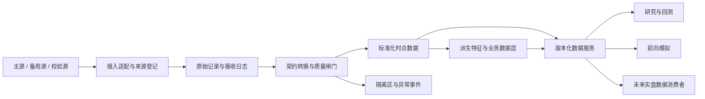

# AI Alpha OS A股量化数据平台架构

所属任务：Sprint 1.4 — Design A Share Quant Data Platform Architecture。

状态：逻辑架构设计，尚未实施。本文重新组织平台职责与数据分层，不选定供应商、存储产品或开发框架，不提供 Python 或其他实现代码。

## 一、设计目标

AI Alpha OS 数据平台不是简单的数据采集模块，而是面向研究、模拟验证及未来自动化交易的量化交易数据基础设施。

| 目标 | 架构要求 | 后续验收依据 |
| --- | --- | --- |
| 稳定 | 批次可重放、质量闸门、合格备用源、故障隔离与恢复流程 | 数据覆盖、延迟、故障和恢复演练记录 |
| 透明 | 来源、字段、时点、算法、修订和决策输入可追溯 | 从 Alpha 输出反查输入快照与处理版本 |
| 可扩展 | 接入适配与业务语义解耦，批量和流式数据使用一致契约 | 新数据源或消费者不改变既有字段含义 |
| 支持开源 | 公开契约、算法说明、质量规则与合成样本 | 开放规范可复现；原始数据授权与软件许可分开管理 |
| 支持未来实盘升级 | 预留低延迟消费、时序一致性、可用性及权限边界 | 阶段升级需有测量、演练、审批与独立实盘授权 |

本次不授予实盘交易权限，不改变 [MVP PRD](../product/MVP_PRD.md) 中的排除项。原始数据、实时展示和再分发必须分别满足来源授权，开源软件不代表数据可自由再分发。

### 1. 平台处理架构

图中的节点表示职责，不要求每个节点独立部署。未来实盘消费者只读取合格数据，订单路由、交易权限和账户风控属于另行设计的执行系统。

| 组件 | 责任与边界 |
| --- | --- |
| 来源登记与接入适配 | 记录 source、原始上游、授权、能力和字段映射；负责拉取或订阅的设计边界，不输出供应商私有字段给 Alpha |
| 原始记录区 | 在授权范围内保留不可变响应、接收时间、序号和校验信息；禁止用清洗结果覆盖原始证据 |
| 标准化区 | 统一身份、单位、时间、主键及修订语义，通过质量闸门后发布快照 |
| 派生区 | 计算板块、梯队、强度及舆情特征，保存输入关联、公式和参数版本 |
| 数据服务 | 提供历史时点查询、固定快照读取和未来实时订阅的语义；具体 API 与技术栈待独立任务定义 |
| 控制与观测 | 维护契约、血缘、质量事件、访问用途、发布状态和恢复记录，贯穿全部数据层 |

研究历史快照与实时最新视图分开发布。实时视图必须可追溯至原始事件；回测不得误读“最新值”覆盖后的历史。批流复用计算语义和版本，最终结果允许因数据到达时间不同而有差异，差异必须可解释。

### 2. 与现有契约的关系

已有字段优先复用 [DATA_CONTRACT.md](DATA_CONTRACT.md)。本文件新增实时行情、梯队派生量和新闻舆情字段为逻辑扩展提案，实施前需补入新 schema_version 并完成兼容性评审，不静默修改旧契约。

原有分钟数据继续作为行情基础和回测输入；板块成员、板块统计、交易日历、权益事件与历史交易规则是跨层依赖。七个业务层不意味着删除这些既有数据集。

## 二、数据分层架构

### 共用字段与约束

所有层继承 record_id、source、event_time、available_at、ingested_at、dataset_version、schema_version、revision、quality_flags 和 lineage_refs。业务时间统一 Asia/Shanghai；价格为元/股，金额为元，成交量为股，比例为小数；decimal 表示逻辑定点数，存储精度待定。

证券身份使用 security_id = exchange:stock_code；代码保持字符串。带 ? 的类型允许 null，必须说明缺失或不适用原因。未知不填零；派生指标还需 metric_version、parameter_version 和计算可用时点。

下列频率是计划的触发方式，不是已取得的数据服务保证。具体延迟、采样间隔、新鲜度阈值、吞吐与保留期，须按来源能力和 Alpha 需求实测后冻结。

### 1. 股票基础信息层

粒度：证券属性有效区间；行业与概念通过历史 sector_membership 关系组成时点视图。

| 字段 | 类型 | 用途 | 更新频率 | 质量要求 |
| --- | --- | --- | --- | --- |
| stock_code | string | 股票代码、证券匹配 | 变更事件触发，日终核对 | 保留前导零，与 exchange 共同唯一识别 |
| stock_name | string | 股票名称与显示 | 更名信息可用后更新 | 保留旧名和生效区间 |
| exchange / board | enum / string | 市场及交易板块，选择适用规则 | 状态变更时，日终核对 | 不从代码猜测未验证规则 |
| industry_ids | array<string> | 行业归属、同行比较 | 分类变更可用后更新 | 关联分类来源、版本和有效期 |
| concept_ids | array<string> | 概念归属、主题分析 | 成员变更可用后更新 | 多成员关系去重，不用当前概念回填历史 |
| listing_status | enum | 上市状态与股票池资格 | 上市或退市事件触发 | 保留退市证券，不能只保留存续样本 |
| effective_from / effective_to | timestamp / timestamp? | 重建当时属性 | 每次属性修订 | 区间不重叠，并按当时可知版本查询 |

行业和概念字段是规范化关系的查询投影，不在主表复制一套无法追溯的自由文本。上市状态不替代停牌等交易状态。

### 2. 日线行情层

粒度：security_id × trade_date，复用 daily_bar。

| 字段 | 类型 | 用途 | 更新频率 | 质量要求 |
| --- | --- | --- | --- | --- |
| open | decimal? | 开盘价、收益路径 | 当日收盘数据发布后；修订追加 | 明确原始不复权口径 |
| high | decimal? | 最高价、区间波动 | 同上 | 有效价格不低于 open、close、low |
| low | decimal? | 最低价、区间风险 | 同上 | 有效价格不高于 open、close、high |
| close | decimal? | 收盘价、日终估值 | 同上 | 区分真实成交与来源估值 |
| volume | int64 | 成交量、活跃度 | 同上 | 非负，统一为股 |
| turnover | decimal | 成交额、流动性 | 同上 | 非负，统一为元，与范围一致 |
| return_rate | decimal? | 涨跌幅 | 日线与 prev_close 可用后派生 | close / prev_close - 1；分母无效则 null |
| prev_close / trading_status | decimal? / enum | 参考价和可交易状态 | 日终发布与状态修订 | 除权日用当日参考前收盘价；停牌不伪造量价 |

日终发布后才可作为完整当日日线；盘中估计不得冒充收盘值。量额统计明确竞价、连续竞价及其他交易方式是否纳入，跨源对比先对齐范围。

### 3. 实时行情层

粒度：证券 × 来源事件序号或快照标识；逻辑数据集 real_time_quote。属于后续能力设计，不表示当前已接入实时接口。

| 字段 | 类型 | 用途 | 更新频率 | 质量要求 |
| --- | --- | --- | --- | --- |
| latest_price | decimal? | 最新价格、盘中估值 | 依源事件推送或受控轮询 | 带事件和接收时点，陈旧值不得标为实时 |
| bids / asks | array<level> | 买卖盘口、流动性观察 | 盘口快照或更新到达时 | level 含 price: decimal、quantity: int64、level_no: int；记录深度与快照/增量类型 |
| cumulative_volume | int64? | 当日累计成交量 | 成交更新或快照到达时 | 同一会话口径下非负；更正与日切重置显式记录 |
| cumulative_turnover | decimal? | 当日累计成交额 | 同上 | 金额单位、范围及重置语义明确 |
| return_rate | decimal? | 实时涨跌幅 | latest_price 更新时 | 基于当日 prev_close，不用未来收盘价 |
| turnover_delta | decimal? | 两个有效快照间成交额变化 | 连续有效快照到达后 | 只在同来源、同交易日和一致口径下相减 |
| estimated_net_flow | decimal? | 按选定方法估计的资金变化 | 依输入到达触发派生 | 必须记录 flow_method_version；不等同于真实资金净流入 |
| source_sequence / quote_status | string? / enum | 去重、乱序与新鲜度控制 | 每次更新 | 无序号时保留快照身份；状态区分 valid、stale、gap、invalid |

累计成交额变化表示交易活跃度，不表示全市场新增资金。基于成交方向分类的“资金流”属于估计特征；没有对应明细数据时 estimated_net_flow 为 null，不根据盘口快照伪造主动买卖成交。

增量盘口发生序号缺口时，停止发布受影响的合格盘口并请求完整快照重建。备用源序号属于独立命名空间，切换后不能接续旧源序号。完整性确认前只提供明确标记的降级视图，禁止关键 Alpha 将其当作有效输入。

### 4. 集合竞价数据层

粒度：证券 × 交易日 × opening/closing × snapshot_time × indicative/final，复用 auction_snapshot 并扩展派生字段。

| 字段 | 类型 | 用途 | 更新频率 | 质量要求 |
| --- | --- | --- | --- | --- |
| reference_price | decimal? | 竞价价格 | 可用快照到达时、最终结果发布后 | indicative 为虚拟价，final 才是最终竞价成交价 |
| matched_volume | int64? | 竞价成交量分析 | 同上 | indicative 是虚拟匹配量，不标作实际成交 |
| matched_turnover | decimal? | 竞价金额、成交活跃度 | 同上 | 保留来源或派生依据，不能混用虚拟量与最终价 |
| auction_return | decimal? | 开盘涨幅候选口径 | 价格与 prev_close 可用后 | opening final 时代表最终开盘竞价涨幅；其他快照明确标注 |
| auction_strength | decimal? | 竞价强度评分输入或输出 | 必需特征均可用且计算完成后 | 记录特征、历史基准、metric_version 和 parameter_version，参数未配置则 null |

竞价强度是派生量，不是原始行情事实；其定义与 [Alpha 评分框架](../alpha/ALPHA_SCORING.md) 共用版本，避免在数据层和评分层分别计算不同口径。

只有 final 数据时不能重建竞价过程。最终竞价结果生成的信号不能回填到已经结束的同次竞价成交。

### 5. 涨停梯队数据层

粒度：冻结股票池 × snapshot_time × metric_version。复用 market_sentiment 中的涨停、炸板和连板数据，扩展首板与晋级统计。

| 字段 | 类型 | 用途 | 更新频率 | 质量要求 |
| --- | --- | --- | --- | --- |
| limit_up_count | int64? | 涨停股票数量、市场强度 | 受控盘中快照；收盘完成后定版 | 盘中为截止时点在涨停价的数量，盘后为收盘涨停数 |
| max_consecutive_limit_up | int64? | 连板高度、梯队上限 | 完整交易日日线可用后 | 盘中仍表示最近已完成交易日高度，禁止标成当日最终高度 |
| first_limit_up_count | int64? | 首板数量、新增强势供给 | 收盘数据与历史状态完整后 | 当前日 consecutive_limit_up_days = 1 的收盘涨停证券数 |
| promotion_rate | decimal? | 昨日 k 板向今日 k+1 板晋级率 | 两日结果均完整后 | 使用冻结 cohort_id 与 promotion_level，分母为 0 则 null |
| failed_limit_up_rate | decimal? | 炸板率、情绪分歧 | 截止时点事件完整后；盘后定版 | 曾触及但截止未封板数量 / 曾触及数量；分母为 0 则 null |
| universe_version / cohort_id | string / string? | 确定统计范围与晋级分母 | 股票池或晋级分组生成时 | 保留历史成员、排除规则和覆盖报告 |

晋级分母为上一完整交易日 k 板候选集合；分子为该集合中今日收盘达到 k+1 板者。停牌等处理沿用冻结规则，不在看到结果后删除失败样本。若候选关键状态未知则晋级率标记不完整，不缩小分母伪造高晋级率。

盘中首板或晋级进展若后续需要，使用独立 provisional 字段与版本，不能写入日终字段。无涨停限制证券、缺失价格及股票池边界遵循数据契约；不同分母的比率不可直接比较。

### 6. 龙虎榜数据层

粒度与 dragon_tiger_seat 一致：披露事件 × 原因 × 买卖方向 × 排名；席位属性作为独立的时点维度关联。

| 字段 | 类型 | 用途 | 更新频率 | 质量要求 |
| --- | --- | --- | --- | --- |
| seat_id / seat_name | string? / string | 买卖席位识别 | 披露发布或修订后 | 保留原始名称，不强行合并疑似同名席位 |
| side / rank | enum / int64 | 买卖方向和排名 | 同上 | 按披露事件、原因和方向去重 |
| broker_branch_name | string? | 营业部归属 | 披露或可核实映射更新后 | 保留映射来源与有效期，未知不猜测 |
| seat_type | enum | institution、broker_branch、other、unknown | 分类证据可用后 | 机构席位依明确披露分类，不映射到未经证明的实际机构身份 |
| buy_amount / sell_amount | decimal? / decimal? | 买卖金额与席位行为研究 | 披露或修订后 | 元为单位，未披露不填零 |
| period_start / period_end / published_at | date / date / timestamp | 统计期间与可用时间 | 每次披露 | 区分单日与多日榜，不提前到交易日开盘使用 |

同一席位可能跨方向、原因和重叠期间出现；聚合必须明确去重单位，不能重复累加。龙虎榜是可选研究输入，不自动成为全部 Alpha 的必需依赖。

### 7. 新闻舆情数据层

采用两个关联数据集：news_event 保存不可变新闻版本；news_feature 保存从新闻派生的主题与情绪，避免把后生成的 AI 标签当作原始新闻字段。

| 字段 | 类型 | 用途 | 更新频率 | 质量要求 |
| --- | --- | --- | --- | --- |
| news_id / event_id | string / string? | 新闻记录和事件聚类 | 新发布或修订到达时 | 单篇唯一；转载聚类保留全部来源关联 |
| title / content_ref / source_url | string / string / string | 新闻事件内容及证据 | 同上 | 仅留存授权内容或引用，保留更正与撤稿 |
| published_at / updated_at | timestamp / timestamp? | 发布及修订时间 | 每个版本到达时 | 不把修订内容回写到初次发布时间 |
| related_security_ids | array<string> | 关联股票和事件影响范围 | 实体识别或人工审核完成后 | 记录抽取版本与歧义，无法确认则不强行关联 |
| hotspot_id / hotspot_score | string? / decimal? | 市场热点与当时关注程度 | 固定滚动窗口结束并计算完成后 | 窗口不得纳入未来新闻，去除重复转载造成的虚假热度 |
| sentiment_score | decimal? | 舆情情绪评分 | 分类任务完成后 | 设计尺度为 -1 至 1；不等于市场情绪周期或收益预测 |
| topic_tags | array<string> | 主题标签、候选事件筛选 | 标签任务完成或复核后 | 标签体系与规则/模型版本可追溯 |
| method_version / confidence / review_status | string / decimal? / enum | 解释派生依据与审核状态 | 每次计算与人工复核 | confidence 为 0–1，阈值待定；状态区分 pending、reviewed、rejected |

该层只定义能力边界，不训练或部署大模型。情绪评分与标签可由后续审查的规则、外部服务或模型产生；无法重建历史模型输入和当时可用标签的结果，只能用于明确标记的回顾探索，不能冒充真实时点样本外验证。

同一事件不同报道不直接视为独立市场证据。撤稿和更正追加新版本并通知受影响研究，历史决策仍保留当时已知版本。

## 三、数据源战略设计

数据源资格与切换治理遵循 [DATA_SOURCE_STRATEGY.md](DATA_SOURCE_STRATEGY.md)。三个阶段按数据能力和验证证据升级，不按日历自动推进。

| 阶段 | 目标 | 来源与能力 | 质量和升级门槛 |
| --- | --- | --- | --- |
| 阶段1：免费研究阶段 | 验证 Alpha | 允许经评估的免费数据源、公开接口和授权历史文件；优先满足可复现研究 | 记录权限、字段覆盖、时间证据和缺口；不具备实时或竞价覆盖时限制相应研究 |
| 阶段2：半自动阶段 | 提高稳定性 | 增加更多数据接口、交叉核验、合格备用源和人工审核；支持受控前向模拟 | 明确人工复核队列、异常处置和主备演练；以连续运行证据验证完整性、延迟与恢复能力 |
| 阶段3：实盘阶段 | 支持自动化交易的数据需求 | 考虑专业行情、Level2、实时数据及独立故障域；按策略需求决定深度和逐笔能力 | 单独确认授权、时延、时钟、容量、缺口恢复、应急演练与审计；策略研究准入和实盘执行仍须独立批准 |

Level2 是可评估的能力，不是已选供应商或当前必需依赖；数据更细不自动代表 Alpha 有效。阶段2的人工审核发生在实际审核时间，不能把确认结果回填到最初数据到达时间。

### 主数据源、备用数据源与数据校验机制

- 按数据集、字段范围、交易市场和用途分别选择主源，不绑定全平台单一数据源。
- 备用源需通过相同用途评估，并证明字段语义、时间、覆盖及授权可替代；记录与主源是否共享原始上游。
- 校验源用于同口径对照，不等于自动可切换的备用源；来源多数一致不能替代对原始事实的核验。
- 建立 source_selection_version，固定每条记录的来源选择。禁止把主备数据重复相加，禁止为了提高回测收益选择有利价格。
- 切换前隔离故障范围、核验备用资格、检查重叠区间并记录批准；切换后发布新版本，恢复源通过复检后才可切回。
- 快照、增量、累计量和时间标签不兼容时，先重建完整状态再恢复发布；流中断期间的数据不能冒充连续完整序列。
- 无合格备用源时保留单源限制；关键数据不可用则阻止依赖它的新信号，并向风控消费者报告降级状态，不伪造新鲜数据。

## 四、数据质量体系

### 1. 数据完整性检查

预期记录集合由历史股票池、交易日历、会话和来源能力生成。检查关键字段、业务键、时段覆盖、序号连续性、成员覆盖和必需依赖。

覆盖率 = 有效业务键数 / 预期业务键数；分母为零标记不适用。停牌、无成交、未披露和采集失败必须区分，不能删除缺失证券来提高覆盖率。

### 2. 时间有效性检查与防止未来函数

- event_time 表示事件或区间结束；available_at 表示该版本最早可被策略使用的时间；ingested_at 表示本平台实际收到的时间。
- 历史时点查询只选 available_at ≤ 决策时刻的版本；前向模拟与未来实盘使用 max(available_at, ingested_at)，不能忽略实际接收延迟。
- 派生 available_at 不早于全部输入可用时间及计算、必要审核完成时间。新模型、修订标签与新闻更正不继承更早的旧内容可用时间。
- 日线收盘统计、晋级率和最终竞价结果均在完成并可用后使用，不能回填到盘前信号。
- 证券状态、板块成员、机构属性、复权因子和新闻主题关联同时考虑业务有效期和当时已知版本。
- 时间不可信或发布时间无法证明时使用保守策略并记录 estimated_availability；不能为了扩大历史覆盖任意提前可用时间。
- 迟到事件可进入新修订快照，不能改写已生成决策；重新计算只形成新实验结果。
- 跨来源时间偏差、异常未来时间和乱序超限均触发隔离；具体容差在消费者接入前冻结。

### 3. 数据一致性检查

检查 OHLC 边界、量额单位、累计量重置、盘口排序、价差异常、竞价类型、涨停适用性、梯队分母、龙虎榜去重及新闻版本关系。

跨源核验先对齐证券、区间、交易方式、复权及分类版本，再比较差异。未经解释的差异保留原始记录并调查，不能简单平均。批量复算与在线特征在相同输入和版本下应一致，差异须记录。

### 4. 数据版本管理

不可变原始记录 → 标准化快照 → 派生版本 → 消费清单 → decision_id，形成完整血缘。

每次发布记录数据版本、契约版本、映射版本、来源选择版本、算法与参数版本、输入清单及质量报告。追加兼容字段与改变字段含义采取不同版本策略；破坏性变更需迁移评审，不静默覆盖。

人工修正、源切换、历史回补和新闻撤稿产生新 revision。回测锁定版本；实验复现读取原清单，不默认使用最新修复值。原始留存、回放容量和保存期限同时受授权与研究复现需求约束。

### 5. 异常报警机制

| 级别 | 示例 | 发布与消费动作 | 处置 |
| --- | --- | --- | --- |
| 阻断 | 关键数据缺失、未来时点、身份错误、增量盘口缺口 | 隔离受影响范围，暂停依赖该范围的新信号；保留已持仓风险状态 | 创建事件，通知数据负责人及相关消费者负责人，确认恢复条件 |
| 警告 | 非关键字段缺失、接近新鲜度阈值、已解释的轻微差异 | 仅在预先允许的降级范围内发布，并附质量标记 | 进入复核队列，记录用途限制及修复期限 |
| 信息 | 已批准源切换、修订发布、计划维护 | 正常版本化发布 | 保存审计与消费者确认 |

事件至少包含 alert_id、数据集、来源、起止时间、受影响证券、检查规则、严重级别、责任人、处置状态和证据引用。相同根因聚合去重，超时未处理按冻结规则升级；恢复须复检通过并记录，不因报警消失自动视为修复。

通知渠道、阈值与响应时限由后续运行设计明确，本次不接入飞书或其他通知服务。报警机制是设计要求，不是已运行服务。

## 五、数据与 Alpha 关系

| Alpha / 用途 | 必需数据支持 | 关键时点与缺失处理 |
| --- | --- | --- |
| 竞价 Alpha | 集合竞价、此前日线或可用行情、历史板块成员与统计 | 区分虚拟与最终竞价；竞价过程缺失时不能声称验证过程特征，板块使用当时成员 |
| 情绪 Alpha / 情绪修复 | 涨停梯队、炸板率、市场成交额与市场日线/可用实时统计 | 冻结股票池、统计时点及分母；日终修复标签不用于当日盘前 |
| 板块强度 Alpha | 板块成员、行情层量价、涨停分布；新闻热点为可选扩展 | 历史成员有效性和覆盖不足时停止相关评分；舆情未验证不自动纳入基线 |
| 龙头强度 Alpha | 股票量价、板块对照、历史连板高度与基础属性 | “龙头”以当时规则确定，不根据未来涨幅倒推 |
| 首板二进场景 | 前一完整日首板候选、竞价、行情、板块和情绪信息 | 当日晋级结果作为后续标签，不能输入同日早期决策 |
| 龙虎榜研究 | 披露后可用龙虎榜、席位属性与量价 | 只在披露和分类可用后使用，明确单日与多日榜范围 |
| 新闻事件研究 | 新闻事件、可追溯主题和情绪、证券关联及行情 | 按内容与派生标签各自可用时间截断，保留转载去重和撤稿记录 |

每个 Alpha 的依赖清单保存所需字段、频率、预热窗口、覆盖范围、允许延迟、来源选择版本、是否可选及缺失处理。依赖失败时输出明确的 insufficient_data 状态，不填零、不临时重分配评分权重。

数据平台提供事实及可解释特征，不负责决定策略有效性。任何策略进入系统前仍须完成 [研究协议](../research/RESEARCH_PROTOCOL.md) 的样本外验证、Paper Trading 与批准流程。

## 六、交付边界与后续设计

本次仅建立架构文档，不开发任何 Python、采集器、接口、模型、实时服务或交易代码。没有真实数据源接入、质量服务运行或生产性能验证。

后续按任务逐步确认：

1. V1 必需层与可选扩展、首批股票池、字段覆盖和历史样本；新闻与完整实时能力不自动扩大 V1。
2. 新字段的契约版本、枚举、业务键、精度及兼容方案，尤其是实时和新闻数据集。
3. 各消费者新鲜度、质量门槛、吞吐、保存期、恢复目标和主备切换演练标准。
4. 合格主备源评估、存储与计算架构 ADR，再拆分实施任务。
5. 用合成验收案例检查未来数据拒绝、迟到修订、竞价回填禁止、历史成员查询、源切换状态重建和新闻撤稿追溯。

以上均为待实施要求，不表示测试已通过或实盘升级已经获准。

[数据索引](README.md) · [数据契约](DATA_CONTRACT.md) · [数据源策略](DATA_SOURCE_STRATEGY.md) · [系统架构](../architecture/README.md)
