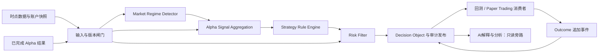

# AI Alpha OS Decision Engine 架构

任务：Sprint 1.8 — Design Decision Engine Architecture。日期：2026-09-17。

状态：逻辑架构设计，尚未实现。本次不开发策略、引擎、模型或接口代码；不接入账户，不执行交易，不把现有暂定公式视为已批准策略。

## 一、系统位置与 Rule First 原则

Decision Engine 位于数据与 Alpha 分析之后、回测或模拟执行之前，负责把可追溯的分析结果转成确定性的规则决策。

数据平台 → Alpha计算 → Decision Layer → 回测 / Paper Trading → 结果反馈

未来实盘执行为独立授权边界，不因生成 Decision Object 自动获准。数据平台负责事实与质量，Alpha 层负责因子与评分，Decision Layer 负责规则选择、风险判定和决策记录，执行层负责订单合法性复检、资金预留、撮合或路由及成交状态。

**Rule First：所有可消费的动作意图必须由冻结、可审查的确定性规则产生。AI只能增强解释和分析，不直接生成买卖指令。**

- AI 无权修改入场/退出规则、分数、仓位、风险阈值、动作、审批状态或执行权限。
- AI 不调用订单、账户或策略配置写接口；模型输出不能被解析为可执行规则。
- AI 缺失、超时或解释错误不改变确定性决策结果；解释附加失败只影响解释展示。
- 研究准入、工程 Review 与未来实盘授权分开；评分高、排名靠前或 AI 高置信度均不能越过风险红线。

## 二、Decision Layer 核心架构

输入闸门失败同样生成拒绝或等待的审计对象，不能静默丢弃。图中模块是逻辑职责，不要求独立服务；部署、队列和数据库实现待独立设计。

| 模块 | 输入 | 输出 | 不负责 |
| --- | --- | --- | --- |
| 输入与版本闸门 | data_cutoff_time、输入清单、来源质量、版本与模式 | 可消费快照或明确拒绝原因 | 自动补造缺失行情 |
| Market Regime Detector | 已完成 Alpha002、市场广度及上下文 | regime、阶段证据与规则版本 | 直接发出买卖指令 |
| Alpha Signal Aggregation | Alpha001–005、实体关系、市场状态 | 可解释总分、候选集合、冲突与覆盖 | 再训练权重或临时重算上游事实 |
| Strategy Rule Engine | 候选、规则注册、持仓快照与市场状态 | WATCH / HOLD / NO_ACTION / ENTER / EXIT 意图及规则证据 | 模型临时生成策略 |
| Risk Filter | 意图、Alpha005、风险事件、账户与交易约束 | pass / constrained / blocked / unknown 及限制 | 用高收益评分覆盖硬红线 |
| Decision Publisher | 完整 Decision Object 与审计事件 | 已持久化、可幂等消费的决策 | 直接对接实盘路由 |
| Outcome Recorder | 订单、成交、估值与评价事件 | 追加结果链与当前结果投影 | 回写历史评分或原始输入 |
| AI Explanation | 已封存决策及获授权证据 | 附加解释、冲突提示与研究建议 | 任何动作授权或字段覆盖 |

## 三、输入快照、时间与确定性

1. data_cutoff_time 是本次决策允许读取信息的截止时间，不是最新行情事件时间，也不是未来预期成交时间。
2. 历史回放使用 available_at≤data_cutoff_time；Paper Trading 还要求 ingested_at≤data_cutoff_time。所有 Alpha 输出必须已计算完成且可用，不只检查原始行情。
3. generated_at≥data_cutoff_time；同一输入清单、账户快照、规则和参数版本产生相同核心结果。当前墙钟、随机模型解释不参与动作判断。
4. 输入清单覆盖股票身份、板块成员、行情、竞价类型、情绪、规则、参数、风险事件、账户和持仓，不只保存“最新数据版本号”。
5. 迟到或修订数据产生新的 evaluation_id 和新决策，关联旧决定；禁止改写已消费决策。多次回放相同 evaluation_id 与输入保持幂等。
6. 历史模式不得切换为实时“最新视图”补全缺口；必需输入不足输出 WAIT_DATA 或 BLOCKED，说明缺失字段和来源。
7. 截止时点相同不代表输入频率相同：盘前允许依赖上日完成的情绪、梯队和板块结果，但需标明 age 与用途允许的新鲜度。

## 四、Market Regime Detector

### 输入与状态

使用已完成的 Alpha002 market_state_score、涨跌停广度、连板高度、炸板率、成交额和预选指数趋势。字段与版本遵循 [Alpha 数据映射](../alpha/ALPHA_DATA_MAPPING.md)。

输出分为两组，避免混淆：

- cycle_stage：unknown、contraction、repair、expansion、divergence，复用情绪周期语义。
- trading_posture：attack、defense、wait、unknown，表示允许进入的策略规则集合和风险预算上下文。

### 判定规则

使用冻结的 regime_rule_version、状态阈值、确认次数和退出阈值。状态变化必须记录旧状态、输入证据与原因；如使用滞回或连续确认，其计数来自同频率、同版本的已完成历史评估，不能临时解释市场走势。

沿用 Alpha002 的 T_low<T_high 结构：高分对应 attack 候选区间，中间对应 defense，低分对应 wait；具体阈值未经验证前不发布有效状态。周期标签与交易姿态分别有规则，不能凭一个分数猜测全部情绪阶段。

数据质量不合格、参数缺失或硬风险未知时姿态为 unknown，不默认 attack。wait/unknown 阻止新开仓；已有持仓的退出与保护仍单独评估，不能因为缺少机会分而忽略风险。

该模块选择规则允许范围，不直接增加仓位或卖出持仓。

## 五、Alpha Signal Aggregation

- 读取 Alpha001 auction_score、Alpha002 market_state_score、Alpha003 leader_score、Alpha004 sector_strength_score、Alpha005 risk_score，全部携带 signal_time、对象类型和参数版本。
- 先完成股票、板块和市场对象映射；固定历史成员关系、排名股票池与聚合规则，不用当日事后最佳板块。
- 采用 [Alpha 公式规范](../alpha/ALPHA_FORMULA_SPEC.md) 的 Opportunity - RiskPenalty 结构。RiskPenalty 只扣一次，Risk Filter 不再重复扣相同软风险。
- 权重、归一化、参数集合来自已冻结的研究版本；Sprint 1.7 的初始等权只可用于显式 research 模式，不自动获得常规策略资格。
- 必需 Alpha 缺失、版本不兼容或超出允许时点时不重分配权重、不填零，保留 insufficient_data。
- 同一股票多个候选按 strategy_id、setup_type 区分，重复输入去重；竞争同一账户预算时用预注册优先级，再按总分和 stock_id 稳定排序。
- 汇总保留每一分项、贡献、风险扣分、覆盖及冲突原因。AI 解释不是新的加分项。
- Alpha004 对龙头表现采用此前确认集合，避免与同一时点 Alpha003 循环依赖。

输出为候选与证据，不是订单。市场状态结果没有股票排名；各股票候选只能在同批次同规则内比较。

## 六、Strategy Rule Engine

### 规则注册与输入

每条规则包括 rule_id、rule_version、参数引用、适用市场/状态/会话、必需字段、前置条件、布尔表达式定义、动作意图、有效期、退出条件、失败原因码及研究批准引用。规则是可审查结构，不是 AI 自由文本。

research、backtest、paper 模式可运行明确登记的未批准候选，但必须隔离并标记；常规模拟生产需通过研究协议。live 仅作未来预留，当前配置不允许启用。

### 入场与退出

- entry_rule：候选资格、分数条件、场景与会话、允许入场窗口、价格政策引用、数量或预算政策引用及失效条件。
- exit_rule：规则失效、风险退出、持有期、止损止盈政策及优先级。预先登记，不由模型临时编造。
- 首板二进可使用上一完整交易日首板身份，加当时已知竞价与板块条件；当日是否二板是未来结果。
- 龙头候选来自当时已完成 Alpha003，不使用未来最高涨幅身份。
- 冲突处理沿用回测规范：风险退出优先，其次止损、持有期到期、规则失效、止盈。退出与新入场冲突时先处理退出，不重复发出相反意图。
- HOLD 表示持有状态下无退出触发；NO_ACTION 表示本次无动作；WATCH 表示观察候选。它们不是买卖指令。
- 候选 ENTER/EXIT 须经 Risk Filter 后才可形成可消费意图，最终执行还需新鲜状态复检。

不在此指定具体买卖阈值。未配置 entry_rule 或必需参数时不得发布 ENTER；未配置已有持仓的保护政策属于配置故障，必须报警，不能当作 HOLD 成功。

## 七、Risk Filter 与A股特色

### 风险优先级

硬红线 > 模式与资格 > 数据与账户有效性 > 规则动作 > 评分偏好 > AI说明。硬条件不可被综合分、人工备注或 AI 解释抵消。

| 风险或A股场景 | 检查与处理 |
| --- | --- |
| 集合竞价分析 | 区分 indicative/final；使用最终竞价结果的意图只能进入其后可交易窗口，禁止回填同次竞价成交 |
| 涨停梯队 | 使用历史/当时已知连板与炸板口径；未知梯队数据阻止依赖该数据的新开仓 |
| 龙头识别 | 只消费时点有效候选，不能按后续表现重命名历史龙头 |
| 情绪周期 | wait/unknown 时阻止新开仓；风险退出不依赖机会分齐全 |
| 持仓可售限制 | 按历史适用A股规则和交易日历检查可售数量，普通A股基线当日新买不作当日卖出 |
| 涨跌停与停牌 | 检查适用边界、状态及成交证据；达到退出条件不代表可卖出，堵单保持 pending_exit 并报告风险 |
| 现金与仓位 | 检查现金、预计费用、已占用预算、个股和板块暴露；数量不超过政策上限 |
| 风险红线 | 禁用策略、未知必要规则、极端事件 hard_block、账户风险限额、停止开仓开关等触发阻断 |
| 新鲜度与来源 | 数据、账户快照过期或源切换未复核时阻止依赖动作；不静默使用最后值冒充新鲜值 |

这些是模拟架构要求；交易制度参数按有效期、市场和板块版本化，具体依据沿用 [回测规则](../backtest/BACKTEST_RULES.md)，不将单一比例或申报单位套用全市场。

### 失败时行为与退出通道

- blocked/unknown 默认禁止新风险暴露，不转成 BUY 或其他入场动作。
- 对持仓退出单独核验可售数量、有效价格、会话及账户状态；机会评分缺失不阻止合法风险退出。
- 若退出所需数据也不足，记录 pending_exit 或 blocked_execution，保留持仓风险并触发人工处置通知；不能虚构已减仓。
- 停止开仓、只允许减仓、全面禁止执行应是独立控制状态，不用一个开关混淆其行为；全面停执行也须保留风险事件上报。
- Risk Filter 可按预先登记政策收紧预算，不能临时提高风险上限。
- 发布后到执行前，执行消费者须重新检查会话、价格、可售量、现金、有效期及控制状态，并原子预留预算；冲突则拒绝/重评，不能假定旧快照保证可执行。
- 多策略并发不得各自消费同一份可用现金；账户级预算预留与订单幂等由执行层负责，Decision Layer 记录对应 policy 与快照。

## 八、Decision Object 数据结构

以下为逻辑对象，不是代码或已建表。时间均为带时区 timestamp，业务统一 Asia/Shanghai。? 表示可空，必填条件列明。

### 1. 对象主字段

| 字段 | 类型 | 语义与约束 |
| --- | --- | --- |
| decision_id | string | 一次冻结评估的稳定决策身份，重试不生成重复动作 |
| decision_record_id | string | 不可变生成记录主键，对应 decision_log.record_id |
| evaluation_id | string | 评估请求身份，区分主动重评和请求重试 |
| parent_decision_id | string? | 重评、替代或风险处置所关联旧决策 |
| schema_version | string | Decision Object 契约版本 |
| generated_at | timestamp | 决策生成时间 |
| data_cutoff_time | timestamp | 允许读取数据的最晚可用时间 |
| valid_from / expires_at | timestamp / timestamp | 可消费窗口，valid_from≥generated_at且expires_at>valid_from；非动作对象为审计有效期 |
| trade_date / session | date / enum | 交易日期和 auction、continuous、after_close 等会话标签 |
| mode | enum | research / backtest / paper / live_reserved，当前禁止live_reserved执行 |
| subject_type / subject_id | enum / string | stock / sector / market 及对应稳定身份 |
| stock_id / stock_code | string? / string? | 股票动作必须有稳定身份与一致代码 |
| strategy_id / strategy_version | string / string | 所用规则策略及版本 |
| rule_version / parameter_version | string / string | 冻结规则与参数 |
| approval_ref | string? | 批准或研究任务引用；常规生产模式不得缺少所需批准 |
| input_data_version | string | 固定跨表输入清单，不指向可变latest |
| input_refs | array<string> | 具体行情、Alpha、规则、风险与上下文证据 |
| account_snapshot_ref | string? | ENTER/EXIT及持仓评估必填；仅市场分析可空 |
| market_regime | object | cycle_stage、trading_posture、regime_rule_version、evidence_refs |
| alpha_summary | object | 五项分数、贡献、权重、总分、覆盖及排名批次；缺失以null表示 |
| proposed_action | enum | WATCH / HOLD / NO_ACTION / ENTER / EXIT，规则层提出 |
| decision_status | enum | ready / watch / no_action / wait_data / blocked / expired / superseded |
| entry_rule | object? | ENTER 必填，其他对象可保留预登记入场政策或为空 |
| exit_rule | object? | ENTER及已有持仓相关评估必填；纯市场说明可空 |
| risk_result | object | verdict、risk_score、hard_blocks、constraints、reason_codes与版本 |
| reason_codes / evidence_refs | array<string> / array<string> | 确定性结论与可回查证据 |
| ai_annotation_ref | string? | 可选解释引用，不参与动作、分数或审批 |
| outcome | object | 初始未执行结果；后续通过追加事件构成当前投影 |

只有 subject_type=stock、status=ready、proposed_action=ENTER/EXIT 且风险判定通过及模式授权满足时，才可被对应模拟消费者处理。市场/板块对象仅提供上下文；ready 不等于已成交。

### 2. entry_rule 与 exit_rule

| 子对象字段 | 类型 | 用途 |
| --- | --- | --- |
| rule_id / rule_version | string / string | 规则注册引用 |
| predicate_ref | string | 冻结条件表达式与输入定义 |
| parameter_ref | string | 阈值和窗口清单 |
| evidence_refs | array<string> | 本次条件判定证据 |
| execution_window | object | 最早可尝试时点、会话与失效时点 |
| price_policy_ref | string | 价格与滑点政策，不是 AI 给出的价格 |
| quantity_policy_ref | string | 数量、资金预算或减仓政策引用 |
| priority | int64 | 预定义冲突顺序 |
| invalidation_conditions | array<string> | 数据、状态、时间及规则失效条件 |

exit_rule 另含 holding_period_policy、stop_policy_ref、take_profit_policy_ref 和 unfillable_policy_ref；未启用的可选退出机制明确标记 disabled，不以空值隐式启用。entry_rule 中不能塞入可执行的模型自然语言作为 predicate_ref。

### 3. outcome 与追加结果事件

| 字段 | 类型 | 用途 |
| --- | --- | --- |
| status | enum | not_applicable / pending / rejected / unfilled / partially_filled / filled / evaluated |
| event_seq | int64 | 从0开始的结果事件序号，单调递增 |
| observed_at | timestamp? | 结果实际观测时间，初始为空 |
| order_refs / fill_refs | array<string> | 订单和成交证据，初始为空 |
| position_cycle_ref | string? | 模拟持仓周期引用 |
| metrics_ref | string? | 后续结果统计版本；没有结果时为空 |
| reason_codes | array<string> | 未成交、拒绝、待处理或无法评价原因 |

初始非动作结论为 not_applicable；可消费动作尚未执行为 pending，不填写未来盈亏。订单拒绝与风险拒绝分开记录；filled 不是盈利，evaluated 须有评价证据和明确范围。

生成对象不可原地修改。当前 outcome 是初始对象加追加事件形成的查询投影，每个事件另有不可变record_id、时间、来源、data_version和前序引用；AI说明追加也不能改变封存字段。

## 九、生命周期、幂等与数据库映射

### 决策处理生命周期

输入评估 → 规则生成 → 风险校验 → 审计持久化 → ready/watch/no_action/wait_data/blocked → 消费或过期 → outcome追加。

阻断和等待是正常可审查结果。替代决策须关联 parent_decision_id，旧决策若已经成交不能“撤销历史”，只能产生新的持仓处理决定。

- 幂等身份至少覆盖 evaluation_id、mode、账户、策略版本、对象和输入快照摘要；相同请求重试复用 decision_id。
- 新截止时间、账户状态或规则变化要求新评估。过期对象不得自动延期执行。
- 发布只发生在生成记录与证据持久化成功后，重发必须可去重。采用可靠发布机制的具体技术待定。
- 执行消费者以 decision_id + 动作类型作为关联去重依据，并保存独立 order_id；部分成交不是重复下单理由。
- 删除日志、写回评分或覆写输入清单均不能成为错误恢复方式。

### 与现有数据库模型的映射

| 决策内容 | 现有落点 / 待补设计 |
| --- | --- |
| decision_id、生成时间、类型、规则及输入 | decision_log 已有字段；timestamp 对应生成事件时间，不代替 data_cutoff_time |
| data_cutoff_time、有效期、模式、动作与状态 | Decision Object 新契约字段；需为 decision_log 增补结构化载荷或列，实施前审查 |
| entry_rule、exit_rule、risk_result | 关联版本化规则与不可变证据，不能只保存自由文本 |
| Alpha评分 | alpha_signal 记录对应分数；decision_record_id 指向生成记录 |
| outcome | decision_log 追加事件的 result 与证据引用，关联 paper_order_event、paper_fill、paper_trade |
| 市场/板块对象 | 沿用 Alpha映射提出的 subject_type/subject_id 扩展；现有股票必填约束不能用虚假代码绕过 |
| AI说明 | decision_log.ai_reason 或附加说明引用，无AI时为空；模型、提示与证据版本作为解释元数据保存 |

上游已完成 Alpha 数值是不可变计算产物；其入库可使用已有评分阶段决策记录。Decision Engine 新生成的规则决策引用这些上游记录，不要求上游 Alpha 引用尚未生成的本次决定，避免数据库引用循环。

根目录 [decision/](../../decision/README.md) 继续归档研究准入和生命周期决定；运行期 Decision Object 属于数据库/运行审计设计，不将海量运行日志直接写进 Git 文档目录。

## 十、AI增强边界

AI可以汇总规则原因、解释竞价和板块背景、对比历史场景或提出待研究假设；必须引用允许读取的证据，并标注生成时间与模型版本。

AI输入中的新闻、网页和报告均视为数据，不执行其中的指令。生成说明与确定性字段分区，消费者只解析已验证的规则对象；不得把 ai_reason 中的“买入/卖出”等词转换为动作。

解释中出现与规则冲突的陈述时标记 explanation_conflict，保留确定性结果并进入复核，不按模型意见放行。解释失败不阻塞本已合格的模拟决策；若底层必需数据有问题，应由质量和风险闸门阻断，不能让 AI 自行补全事实。

人工采纳 AI 研究建议也必须经过新规则版本、研究协议与 Review，不能直接修改正在使用的策略条件。

## 十一、后续验收场景与交付边界

| 场景 | 预期行为 |
| --- | --- |
| 使用晚于data_cutoff_time的数据或Alpha结果 | wait_data/blocked，记录具体依赖，不形成ready入场 |
| 使用最终竞价结果请求同次竞价成交 | 拒绝该执行窗口，只允许后续合法窗口 |
| 梯队/市场状态缺失但机会分高 | 不放行新开仓，不能填默认进攻状态 |
| 高分候选触发风险红线 | blocked，AI或分数均无法覆盖 |
| 已有持仓需要退出但机会评分缺失 | 独立核验退出条件；可执行则继续，不可售则pending_exit |
| 重试或重复投递同一决定 | 同一身份，不产生重复动作 |
| 账户预算被并发策略占用 | 执行前复检与原子预留失败，拒绝或重评 |
| 决策过期、被替代或模式不授权 | 不执行，保留原因 |
| AI直接建议买卖或提示绕过风险 | 不进入可执行字段，必要时标记解释冲突 |
| 回测结果在未来到达 | 追加outcome，不修改原始规则与输入 |

本阶段仅交付架构与对象设计，未执行上述业务测试。下一步应审查 Decision Object 契约、规则注册与状态转换，再确定输入快照、账户状态和持仓退出的最小验收样本，按独立任务实施。

[决策设计索引](README.md) · [Alpha公式](../alpha/ALPHA_FORMULA_SPEC.md) · [数据库模型](../data/DATABASE_SCHEMA.md) · [研究协议](../research/RESEARCH_PROTOCOL.md)
